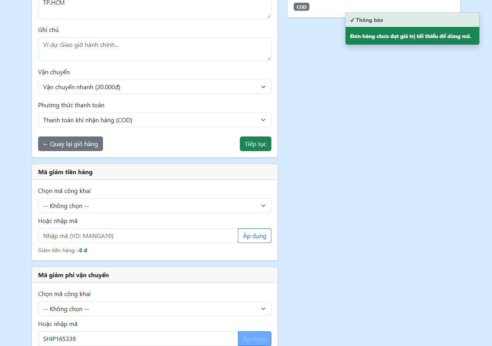
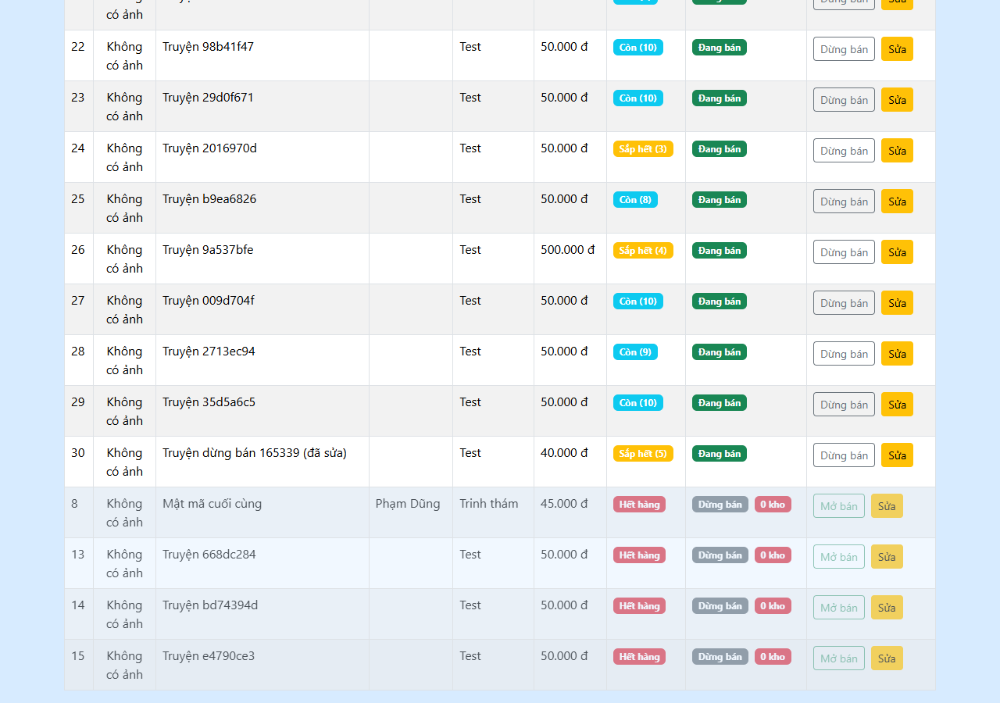

# Báo cáo lỗi TruyenHub

Môi trường chung: Windows 11, Chrome, backend profile `local` (cổng 8080), frontend (cổng 5173), MySQL 8.0.46 (cổng 3307). Ngày: 2026-11-26. Trạng thái của cả 5 lỗi: **Open**.

| Mã | Lỗi | Mức độ | Ưu tiên |
|---|---|---|---|
| BUG-01 | Bán vượt tồn kho khi nhiều người đặt cùng lúc | Critical | Cao |
| BUG-02 | Tài khoản bị khóa vẫn gọi được API | Critical | Cao |
| BUG-03 | Nhập sai nhưng API trả 500 thay vì 400 | Medium | Trung bình |
| BUG-04 | Mã ship so "đơn tối thiểu" với phí ship | Medium | Trung bình |
| BUG-05 | Sửa truyện làm truyện đã dừng bán được mở bán lại | Medium | Trung bình |

---

## BUG-01: Bán vượt tồn kho khi nhiều người đặt cùng lúc

- **Test case:** TC-ORD-03
- **Tiền điều kiện:** truyện A còn 1 cuốn; 8 khách đều có 1 cuốn A trong giỏ.
- **Bước:** 8 khách gọi `POST /api/orders` cùng lúc.
- **Mong đợi:** 1 đơn thành công, 7 đơn bị từ chối vì hết hàng.
- **Thực tế:** cả 8 đơn trả 200, lặp lại 3/3 lần chạy. Database: kho ghi 0 nhưng đã bán 8 cuốn.

```sql
SELECT c.id, c.stock, COUNT(oi.id) AS so_don, SUM(oi.quantity) AS da_ban
FROM comics c JOIN order_items oi ON oi.comic_id = c.id
WHERE c.id = 13 GROUP BY c.id;
-- id 13 | stock 0 | so_don 8 | da_ban 8
```

- **Ảnh hưởng:** cửa hàng nhận tiền của 7 đơn không có hàng để giao.
- **Nguyên nhân (đọc code):** `OrderServiceImpl` nạp giỏ hàng kèm truyện (dòng 119) trước khi khóa dòng (dòng 138). Khóa có tác dụng, nhưng Hibernate vẫn dùng số tồn kho đã nạp từ trước.

## BUG-02: Tài khoản bị khóa vẫn gọi được API

- **Test case:** TC-SEC-03
- **Bước:** 1. Khách đăng nhập, giữ token. 2. Admin khóa tài khoản. 3. Dùng token cũ gọi `GET /api/users/me`.
- **Mong đợi:** 401 hoặc 403.
- **Thực tế:** 200, trả đủ thông tin tài khoản.
- **Ảnh hưởng:** khóa tài khoản không có tác dụng cho đến khi token hết hạn (mặc định 24 giờ).
- **Nguyên nhân (đọc code):** trạng thái `active` chỉ được kiểm tra lúc đăng nhập, `JwtAuthFilter` không kiểm tra.

## BUG-03: Nhập sai nhưng API trả 500 thay vì 400

- **Test case:** TC-AUTH-02
- **Bước:** gọi `POST /api/auth/register` với mật khẩu `abc12`.
- **Mong đợi:** 400 và thông báo "Mật khẩu tối thiểu 6 ký tự".
- **Thực tế:** 500, nội dung lộ tên class bên trong:

```json
{"type":"org.springframework.web.bind.MethodArgumentNotValidException",
 "message":"Validation failed for argument [0] in public ... com.comicstore.comicstore_backend.controller.AuthController.register(...)"}
```

- **Phạm vi:** BUG-04 cũng trả 500 cho lỗi nghiệp vụ (`BadRequestException`).
- **Nguyên nhân (đọc code):** `GlobalExceptionHandler` chỉ xử lý riêng lỗi 404, mọi lỗi khác thành 500.

## BUG-04: Mã ship so "đơn tối thiểu" với phí ship

- **Test case:** TC-DISC-02
- **Bước:** 1. Admin tạo mã giảm 15.000 phí ship, đơn tối thiểu 200.000. 2. Khách thêm truyện 250.000 vào giỏ. 3. Nhập mã ship, bấm "Áp dụng". 4. Bấm "Tiếp tục".
- **Mong đợi:** đặt hàng thành công, tổng 255.000.
- **Thực tế:** bước 3 chấp nhận mã (giảm 15.000, tổng 255.000). Bước 4 bị từ chối: "Đơn hàng chưa đạt giá trị tối thiểu để dùng mã."
- **Ghi nhận thêm:** thông báo lỗi hiện nền xanh, dấu ✔ như thông báo thành công.
- **Nguyên nhân (đọc code):** `OrderServiceImpl` dòng 258 truyền phí ship (20.000) vào chỗ cần tiền hàng.



## BUG-05: Sửa truyện làm truyện đã dừng bán được mở bán lại

- **Test case:** TC-ADM-01
- **Bước:** 1. Admin bấm "Dừng bán" một truyện còn 5 cuốn. 2. Bấm "Sửa", đổi tên, "Lưu thay đổi".
- **Mong đợi:** trạng thái vẫn "Dừng bán".
- **Thực tế:** trạng thái thành "Đang bán" (dòng id 30 trong ảnh).
- **Ảnh hưởng:** khách mua được truyện mà cửa hàng đã chủ động ngừng bán.
- **Nguyên nhân (đọc code):** `ComicServiceImpl.updateComic` đặt `active = stock > 0` mỗi lần lưu.


