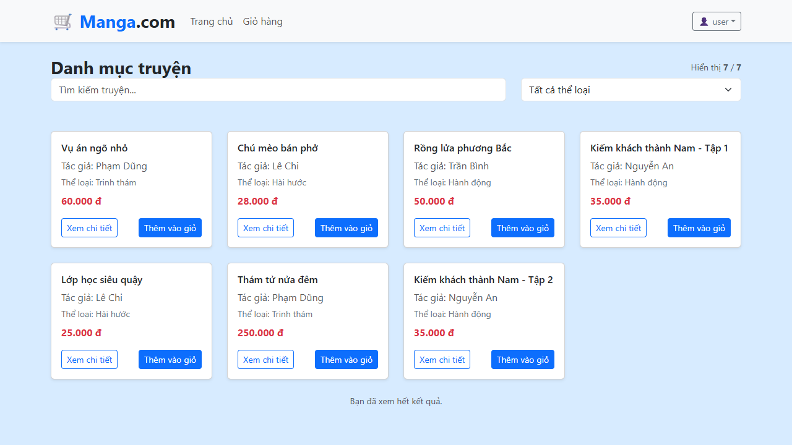
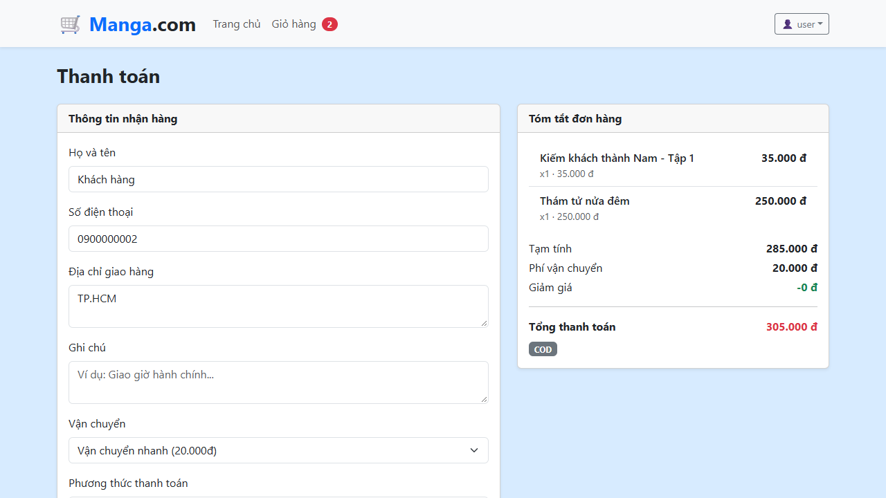
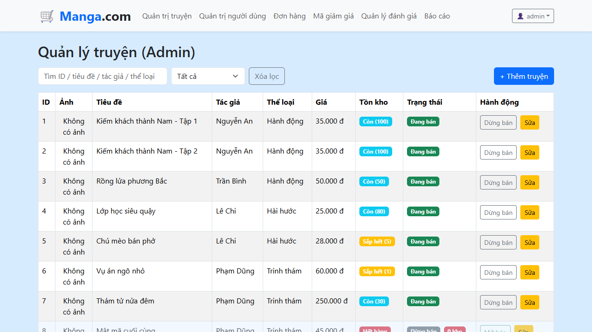
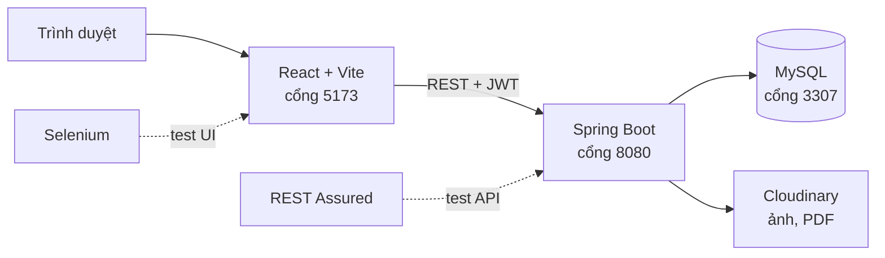

# TruyenHub


Web bán truyện gồm trang mua hàng cho khách và trang quản trị cho admin, kèm bộ **kiểm thử tự động API và UI**.



## Mục lục

- [Kiểm thử](#kiểm-thử)
- [Chức năng](#chức-năng)
- [Công nghệ và cấu trúc](#công-nghệ-và-cấu-trúc)
- [Chạy trên máy](#chạy-trên-máy)
- [Chạy test](#chạy-test)

## Kiểm thử

| Nội dung | Kết quả |
|---|---|
| Test case | 20, áp dụng phân vùng tương đương và giá trị biên ([xem](AutomationTests/docs/test-cases.md)) |
| Tự động hóa | 18: 12 test API (REST Assured), 6 test UI (Selenium, Page Object Model) |
| Lần chạy 26/11/2026 | 15 test hồi quy đạt; 3 test đỏ do lỗi của ứng dụng chưa sửa |
| Lỗi tìm được | 5, trong đó 2 lỗi Critical ([xem](AutomationTests/docs/bug-reports.md)) |

Lỗi nổi bật: truyện chỉ còn 1 cuốn, 8 khách đặt cùng lúc thì **cả 8 đơn đều thành công**. Kho ghi 0 nhưng đã bán 8 cuốn.

## Chức năng

| Khách hàng | Admin |
|---|---|
| Đăng ký, đăng nhập, sửa hồ sơ, đổi mật khẩu | Thêm, sửa, dừng bán truyện; quản lý tồn kho |
| Tìm truyện theo tên, lọc theo thể loại | Xem và đổi trạng thái đơn hàng |
| Giỏ hàng, đặt hàng COD; VNPay và MoMo giả lập | Tạo mã giảm tiền hàng, mã giảm phí ship |
| Dùng mã giảm giá, theo dõi đơn hàng | Khóa và mở tài khoản khách |
| Đánh giá truyện đã mua | Quản lý đánh giá; báo cáo doanh thu, xuất CSV |

| Thanh toán | Quản trị truyện |
|---|---|
|  |  |

## Công nghệ và cấu trúc



| Thư mục | Nội dung | Công nghệ chính |
|---|---|---|
| [`BackendHub`](BackendHub) | REST API | Java 21, Spring Boot, Spring Security, JPA |
| [`FrontendHub`](FrontendHub) | Giao diện | React, Vite, React Bootstrap, Axios |
| [`AutomationTests`](AutomationTests) | Kiểm thử tự động | Selenium, TestNG, REST Assured, Maven |

## Chạy trên máy

**Cần có:** JDK 21, Node.js 20.19+ (hoặc 22.12+), Docker Desktop đang mở. Không cần cài Maven. Các lệnh dưới đây dùng PowerShell.

**1. Database**

```powershell
docker compose up -d --wait
```

**2. Backend** (http://localhost:8080)

```powershell
cd BackendHub
.\mvnw.cmd spring-boot:run "-Dspring-boot.run.profiles=local"
```

**3. Frontend** (http://localhost:5173), mở terminal khác

```powershell
cd FrontendHub
npm ci
npm run dev
```

| Tài khoản mẫu | Email | Mật khẩu |
|---|---|---|
| Admin | `admin@truyenhub.local` | `123456` |
| Khách | `user@truyenhub.local` | `123456` |

<details>
<summary>Đưa dữ liệu về ban đầu, upload ảnh</summary>

- **Đưa dữ liệu về ban đầu:** tắt backend, chạy `docker compose down -v`, rồi làm lại từ bước 1. Lệnh này xóa hết dữ liệu local.
- **Upload ảnh, PDF:** đặt biến môi trường `CLOUDINARY_CLOUD_NAME`, `CLOUDINARY_API_KEY`, `CLOUDINARY_API_SECRET` trước khi chạy backend.

</details>

> [!WARNING]
> Profile `local` chỉ dành cho máy cá nhân. Mật khẩu và khóa JWT của nó là công khai, không dùng trên server thật.

## Chạy test

Khi cả ba phần trên đang chạy và máy có Chrome, mở terminal ở thư mục gốc:

```powershell
cd AutomationTests
..\BackendHub\mvnw.cmd test
```

Chi tiết ở [README của phần kiểm thử](AutomationTests/README.md).
